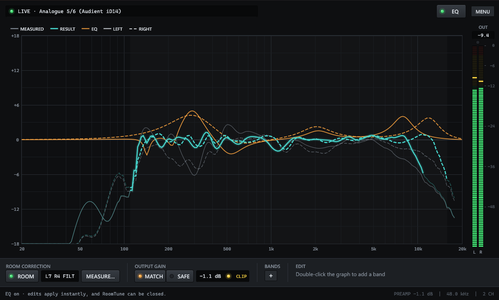

# RoomTune — room correction & EQ for Windows



RoomTune is one app for one-time microphone room calibration and manual EQ. It applies the result to **all Windows playback**, even after you close it.

It is a single native executable (`room-tune.exe`, about 7 MB, Rust + egui). It has no .NET, Electron, browser, account, or background service of its own.

## How playback works

Windows only allows system-wide EQ inside its audio engine, as an audio processing object (APO). RoomTune uses the open-source [Equalizer APO](https://sourceforge.net/projects/equalizerapo/) engine and **sets it up for you**. On the setup screen, one button does all of this, with a single Windows permission prompt:

1. Downloads Equalizer APO 1.4.2 (12 MB) and checks it against a pinned SHA-256, which matches the Chocolatey package checksum.
2. Copies it to an admin-only folder, checks it again, and installs it silently. The installer opens Equalizer APO's Device Selector; RoomTune closes it immediately.
3. Enables the engine on your speakers with the same registry changes the Device Selector makes, so Equalizer APO's uninstaller still undoes them.
4. Restarts Windows audio. If that fails, RoomTune asks you to restart Windows instead.

Equalizer APO's installer gives users write access to its config folder. After setup, EQ edits are written directly and heard within about a quarter second, with no further permission prompts.

## Use

- **Setup screen (first launch):** pick your speakers and measurement microphone; each has a live level meter. Then install or enable the playback engine. You can come back later via ••• › Devices & engine.
- **Graph:** shows both speakers at once, left solid and right dashed. You see the measured response, the response with EQ, and the EQ curve, with a live output meter beside it.
- **EQ switch** (top bar): turns the EQ on or off, so you can compare by ear.
- **Measure…:** opens a guided multi-position measurement (1, 3, 5 or 7 mic positions; 5 is the default). A small diagram shows where to place the mic for each position. Each position plays a noise baseline and a 10 s sweep per speaker. The positions are power-averaged, which removes comb-filter detail that exists only at one spot. If the EQ is on, it is bypassed for the session and the new result is applied afterwards.
- **Correction:** RoomTune corrects each speaker toward a flat target across its **usable range**, the band where the speaker's response is within 6 dB of its midrange level. It never boosts where the speaker rolls off.
  - Fitting uses the smoothed response: 1/12 octave in the bass, widening to 1/3 octave by 4 kHz.
  - Up to 16 filters per speaker: cuts down to −12 dB, and boosts up to +6 dB that are broad (Q ≤ 2) and kept away from the range edges.
  - Peaks are weighted more than dips, so deep notches aren't chased.
- **Import SoundID measurement…** (menu): reads the averaged, mic-calibrated left/right responses from a SoundID Reference `.swproj` project and fits RoomTune's correction to them.
- **ROOM** button: switches room correction on or off. Hover to see the fitted filters, the corrected range, and any low-SNR regions left uncorrected. Measurements saved before full-range fitting are re-fitted automatically on start.
- **Manual EQ:** one shared EQ for both speakers, with up to 16 peak, low-shelf, or high-shelf bands.
  - Add bands with **+ Band** or by double-clicking the graph.
  - Drag a point to change frequency and gain; scroll over it to change Q.
  - Edit the selected band in the strip below the graph. Delete removes it.
- **••• menu:** Open or Save a `.roomtune` file (room correction plus manual EQ), Export for Equalizer APO (plain filter text), and the demo.

RoomTune adds a shared preamp of 1 dB plus the largest boost, so EQ boosts can't clip.

## Files

- `%LOCALAPPDATA%\RoomTune\`:
  - `eq.roomtune`: your current EQ
  - `last-measurement.roomtune`: the latest room measurement
  - `settings.json`: chosen devices
  - `downloads\`: the verified engine installer

Raw recordings stay in memory only.

In Equalizer APO's config folder (`C:\Program Files\EqualizerAPO\config`):

```
config.txt                     Your config plus one marked include block (added once)
RoomTune\active.txt            Current EQ, or a bypass comment
RoomTune\last-enabled.txt      Last enabled EQ
RoomTune\config-backup-*.txt   Copy of config.txt from before RoomTune changed it
```

**To remove everything:** uninstall *Equalizer APO* in Windows Settings › Apps; this also restores your speakers' original audio effects. To remove only RoomTune's EQ, delete the lines between the `ROOMTUNE MANAGED BLOCK` markers in `config.txt`.

## Limits

- Correction targets flat; there is no house curve or tilt yet. Use manual EQ for taste.
- An uncalibrated microphone's own response stays in the measurement, especially above about 8 kHz. Load the mic's calibration file, or import a SoundID measurement.
- The "with EQ" curve is a prediction, not a second measurement.
- **ASIO and WASAPI exclusive-mode playback bypass the engine**, for example DAWs using native drivers and some games.
- Automatic engine setup supports x64 Windows only. One EQ applies to one output at a time.
- Some drivers need a full Windows restart before the engine runs.

## Build and test

Requires Rust 1.88+ (edition 2024) on Windows.

```powershell
cargo build --release          # target\release\room-tune.exe
cargo test --release           # no audio, downloads, or system changes
cargo run --release --example levels -- --tone "Analogue 1/2"   # diagnose: is audio reaching an output?
```

The tests cover:
- measurement maths, position averaging, smoothing, and full-range fitting (speaker-range limits, boost rules);
- SoundID curve import;
- filters matching Equalizer APO's biquads;
- exported frequencies surviving Equalizer APO's parser;
- EQ export, headroom, and limits;
- `.roomtune` loading;
- config preservation and live re-apply against a fake engine folder;
- engine install-mode selection.

`room-tune.exe --demo` starts with demo data. `--helper …` is the internal elevated helper.

## Layout

| Path | Role |
|---|---|
| `src/main.rs` | egui UI: setup screen, graph, band editor, meters, live apply |
| `src/eq.rs` | EQ model: bands, shelves, room + manual combination, headroom |
| `src/engine.rs` | Engine download/verify, silent install, endpoint registration |
| `src/apo.rs` | Engine config files, managed block, elevated helper |
| `src/audio.rs` | WASAPI device listing, sweep playback, capture, level meters |
| `src/dsp.rs` | Sweep, FFT analysis, room-correction fitting |
| `src/profile.rs` | Room measurement profiles, atomic writes |
| `src/platform.rs` | UAC, registry & permissions, WinHTTP download, processes |
| `src/soundid.rs` | SoundID Reference `.swproj` measurement import |
| `examples/levels.rs` | Diagnostic: output levels and test tone |
| `examples/fit_report.rs` | Diagnostic: fit a `.roomtune` or `.swproj` measurement and print the result |
| `tests/core.rs` | Integration tests |

RoomTune is MIT licensed (see `LICENSE.txt`). Equalizer APO is GPLv2. RoomTune downloads the unmodified official installer and interacts with it only through registry entries and its [documented config files](https://sourceforge.net/p/equalizerapo/wiki/Configuration%20reference/).
